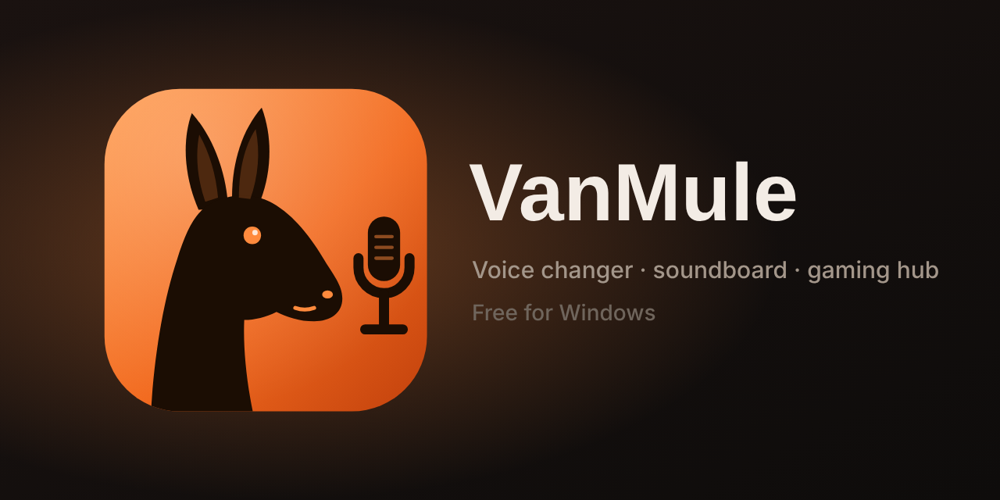

<p align="center"></p>

# VanMule

A free voice changer and soundboard for Windows, with a gaming hub built in.

Pick a voice, talk, and your friends on Discord (or in any game) hear the changed voice. Add your own AI voice models, fire off soundboard clips, record gameplay, put a crosshair on any game, and keep an eye on your teams, stocks and deals from the same window.

**[Download the latest installer](../../releases/latest)** · Windows 10 / 11 · free, no account

> Windows SmartScreen may warn that the installer is from an unknown publisher, because it isn't code-signed yet. Click **More info → Run anyway**.

## What's in it

**Voice**
- Effect voices (robot, deep, chipmunk, radio and more) and your own stacked effects in the Voice Lab
- AI voices: import RVC v2 models (.pth or .onnx) and talk through them in real time on your graphics card, with a fast / accurate pitch tracker and an Auto mode that keeps up with your PC
- Hold-to-talk voice, a voice per game, text to speech, noise removal, a mini overlay that sits over your game
- Virtual microphone: one-time setup installs the free VB-Audio cable so Discord and games pick up the changed voice

**Soundboard** · clips with hotkeys, boards and folders, record your own, say-it-in-your-voice, background music under your voice

**Record** · gameplay with game audio and your changed voice, instant replay (save the last 30 s), voice messages for Discord, multi-voice conversations

**Gaming** · crosshair overlay with an editor and a library, performance overlay (FPS, CPU, GPU, temps), volume mixer overlay, PC build summary, 34 Arcade games (pinball, chess with a coach, blackjack, poker, sudoku, air hockey, mini golf…) with controller support

**Hub** · Watch (your teams' games with scores, lines, standings, TV shows and movie releases on one calendar, fantasy leagues, bets), Stocks (charts, watchlist, alerts), Shopping (Slickdeals, sneaker and card drops), Memes, desktop Widgets

## AI voices: the rules

VanMule doesn't include, search for or download voice models. What you import is your choice and your responsibility.

- Only use voices you made or have permission to use.
- Never use a real person's voice to make people think it's really them, or to harass, scam or mislead anyone. In many places that's illegal as well as wrong.
- The safest voice is one you trained yourself from your own recordings.

The AI engine needs a one-time download of two shared models (a speech encoder and a pitch tracker, about 740 MB) the first time you use an AI voice.

## Building from source

```
npm install
npm start                 # run it
bash tools/make-release.sh   # build dist/VanMule-Setup-<version>.exe (needs makensis)
```

Some features use free third-party APIs (TMDB, OMDb, RAWG, IsThereAnyDeal, The Odds API, Yahoo Fantasy). Copy `keys.example.json` to `keys.json` and fill in whatever keys you have; everything else works without them, and users can also enter their own keys in the app's Setup pages.

The user interface is a single file, `app/index.html`. The main process is `main.js` with `pcstats.js` (performance helpers) and the AI engine in `engine/`.

## Privacy

VanMule has no account and no server of its own. It talks directly to the public services behind each feature (ESPN scores, Yahoo Finance quotes, Slickdeals, Hugging Face for the engine models, and so on). Your settings, voices and recordings stay on your PC.

## License

MIT. See [LICENSE](LICENSE). Third-party components and their licenses are listed in [THIRD-PARTY-NOTICES.md](THIRD-PARTY-NOTICES.md).
